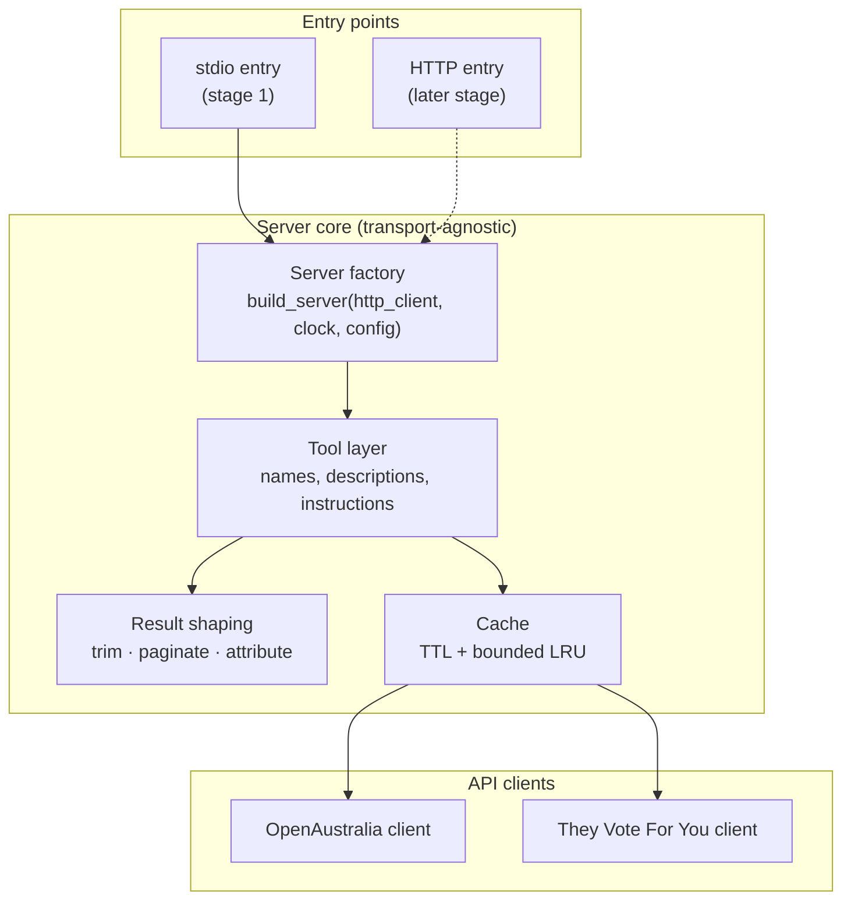
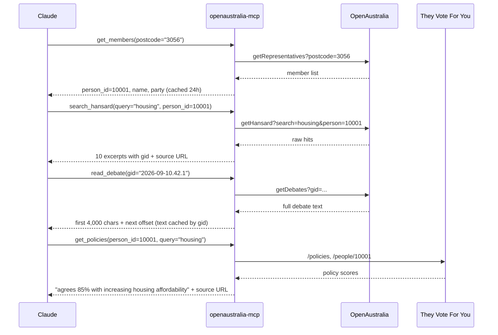
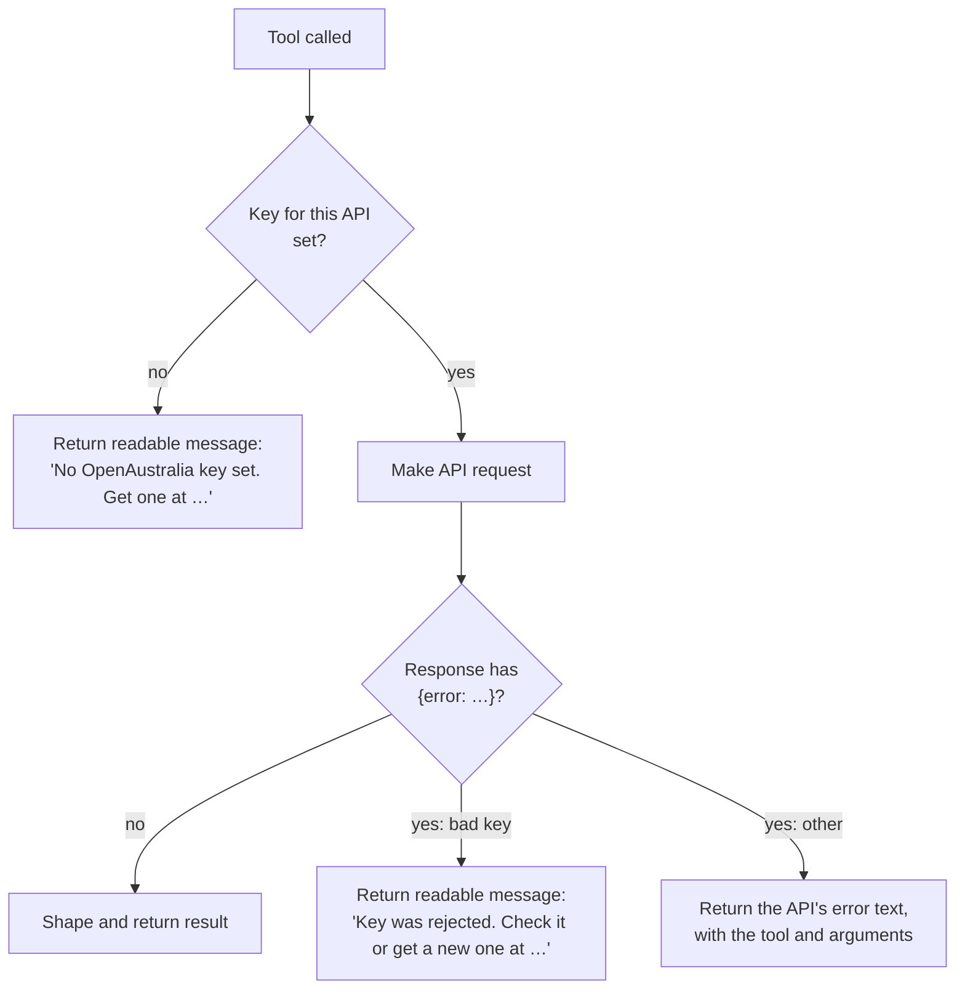
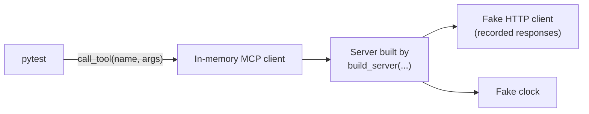
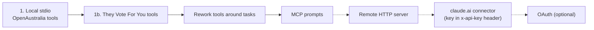

# Architecture

How the OpenAustralia MCP server is put together, and why. This is a draft written before any code exists. Where something hasn't been verified yet, it's marked **unverified**.

## Overview

The server is a local MCP server, written in Python, that Claude Desktop or Claude Code starts as a child process and talks to over stdio. When Claude calls a tool, the server makes the matching HTTP GET calls to OpenAustralia or They Vote For You, cuts the response down to what the model needs, adds a source link, and returns it.

The server stores nothing on disk and never changes data. Keys are read from the environment the client passes to the process.

## Components

| Component | Responsibility |
|---|---|
| **Entry points** | Read config, build the server, attach a transport. Stage 1 ships stdio only. The HTTP entry point is a later addition and doesn't change the core. |
| **Server factory** | The single construction point. It takes an HTTP client, a clock and the config, so tests can swap in fakes (see [Testing](#testing)). |
| **Tool layer** | Registers the tools with the `mcp` SDK (`MCPServer`, called FastMCP before 2.x) and holds the descriptions and the server `instructions` that tell the model how to chain tools. |
| **Result shaping** | Turns raw API responses into small, citable results. This is where most of the design work goes. |
| **Cache** | Avoids repeat calls for data that rarely or never changes. |
| **API clients** | One per API. They build requests, attach the key, and turn error responses into typed errors. They don't know anything about MCP. |

## Tools

At first the tools follow the API functions one to one, with three changes: results are trimmed, results include the IDs the next call needs, and some names are changed so they don't mislead the model. Once real use shows where Claude struggles, the tools will be reworked around tasks.

| Tool | API call(s) | Returns |
|---|---|---|
| `get_members` | OA `getRepresentatives`, `getRepresentative`, `getSenators`, `getSenator` | Members with `person_id`, house, party, electorate/state |
| `get_electorates` | OA `getDivisions` | Electorates (electoral divisions) |
| `search_hansard` | OA `getHansard` | 10 hits: speaker, date, house, ~300-char excerpt, `gid`, URL |
| `read_debate` | OA `getDebates` (by `gid`) | Up to ~4,000 characters per call, plus `offset` for the next page |
| `get_policies`, `get_policy` | TVFY `/policies` | Policy topics, with each member's agreement score |
| `get_votes`, `get_vote` | TVFY `/divisions` | Individual votes and how each member voted |

Notes on naming:

- **"Divisions" means two different things.** OpenAustralia's `getDivisions` returns electorates, while They Vote For You's `/divisions` returns votes. The tools are named `get_electorates` and `get_votes` so the model can't mix them up.
- **Only one tool looks up members.** They Vote For You's people data is folded into the policy and vote results instead of getting its own tool.
- **`getComments` is left out.**

Exact parameters per tool are **unverified**: both docs sites are behind a Cloudflare challenge. They'll be taken from the `openaustralia` Python package source and from live calls.

## A typical question

"What has my MP said about housing, and how do they vote on it?"

Every result includes the IDs the next call needs (`person_id` → `gid`). The model never has to guess at API syntax.

The last step depends on They Vote For You using the same `person_id`s as OpenAustralia. That's **unverified**, and it's the first thing to check once live keys are available. If the IDs differ, the server has to match people across the two APIs, and splitting it into two servers becomes the better option.

## Keys and errors

- **Validation is lazy.** The server always starts, and a key problem comes back as a tool result that Claude can explain to the user. Failing at startup would only show up in Claude Desktop as an unhelpful "server disconnected".
- **Each key is independent.** Missing a They Vote For You key disables only the voting tools.
- **Keys never appear in logs, results or errors.**

## Result shaping

Hansard responses are long, and model context is limited. The rules:

| Rule | Default |
|---|---|
| Search hits per page | 10 |
| Excerpt length | ~300 characters, cut on a word boundary |
| `read_debate` page size | ~4,000 characters, with an `offset` for the next page |
| Attribution | Every result ends with a source URL and the licence line |
| Hansard text | Cut, never rewritten or summarised on the server (CC BY-NC-ND: no derivatives) |

These defaults are starting values, to be tuned once recorded responses show real sizes.

## Caching

The cache is in memory only, and is lost when the process exits.

| Data | Policy | Why |
|---|---|---|
| Members, electorates | 24-hour TTL | Rarely change, and almost every question looks up a `person_id` |
| TVFY policies | 24-hour TTL | Rarely change |
| Debate text (by `gid`) | Bounded LRU (~50 items) | Published Hansard never changes, and paging with `offset` would otherwise download the whole debate again for every page |
| Searches | Not cached | New sitting days change the results, and a stale search could silently miss today's debate |

## Testing

The tests use a single seam, the MCP tool call, plus two dependencies the factory injects.

- **Unit tests** call tools through an in-memory MCP client, the same way a real client does, and check the result: trimming, IDs, attribution and error messages. HTTP is served from recorded responses, so no key is needed and the tests run in CI.
- **Cache tests** move the fake clock forward to check the TTL, and count HTTP calls to check that paging through one `gid` fetches it only once.
- **Live smoke tests** use the same tool-level seam with a real HTTP client. They run only when the key env vars are set.
- **Manual testing** uses MCP Inspector.

Nothing below the tool call is tested on its own. That keeps the internals free to change when the tools are reworked around tasks.

## Key decisions

| Decision | Choice | Reason |
|---|---|---|
| Language | Python, `uv`, the official `mcp` SDK (2.x) | Less boilerplate. The focus is MCP, not the language. |
| HTTP client | `httpx2` | The `mcp` 2.x SDK already depends on it, so the server has one HTTP stack, not two |
| Transport | stdio first, with a transport-agnostic core | Local use needs no hosting, and HTTP can be added later without a refactor |
| Servers | One server, two API clients | Speech and votes join on the member, and one server can name things clearly |
| Tool shape | One tool per API function, for now | Real usage should drive the redesign around tasks |
| Workflow guidance | Server `instructions` and tool descriptions | The model always sees these. Prompts and resources are chosen by the user, not the model. |
| Key validation | On first call | Readable errors instead of an opaque startup crash |
| Distribution | `uvx --from git+…` | No release process needed. PyPI later. |
| Code licence | MIT | Data licences are documented separately |

## Open questions

- Does They Vote For You use the same `person_id`s as OpenAustralia? This decides whether one server is still the right call.
- What exact parameters does each OpenAustralia and They Vote For You function take?
- How well do the result-size defaults hold up against real responses?

## Later stages

For the remote stages, the server would read keys from request headers instead of env vars, for each request. The core stays the same. Only the entry point and how the config is supplied change.
