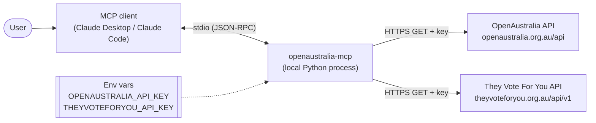
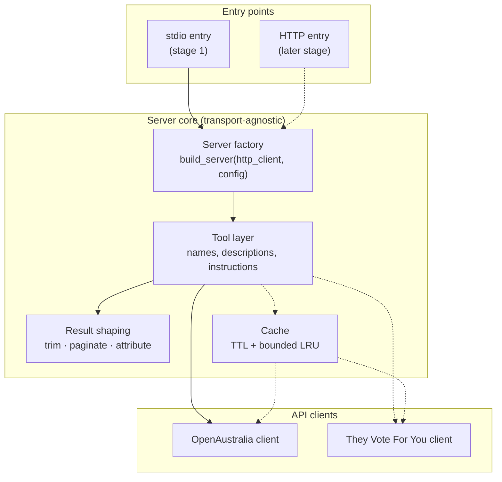
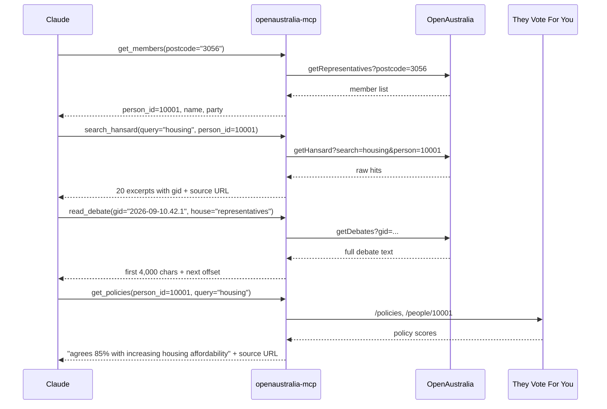
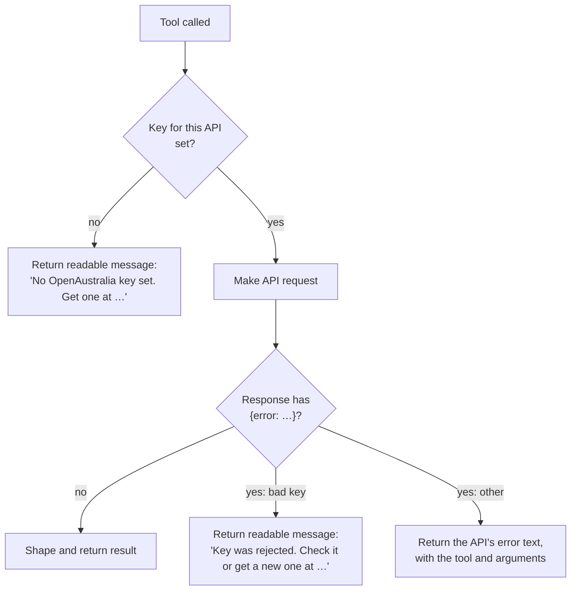
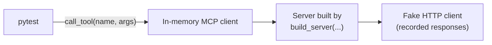
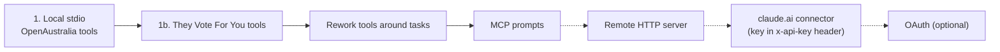

# Architecture

How the OpenAustralia MCP server is put together, and why. It started as a draft before any code existed, and it's updated as tools are built. Where something hasn't been verified yet, it's marked **unverified**.

## Overview

The server is a local MCP server, written in Python, that Claude Desktop or Claude Code starts as a child process and talks to over stdio. When Claude calls a tool, the server makes the matching HTTP GET calls to OpenAustralia or They Vote For You, cuts the response down to what the model needs, adds a source link, and returns it.

The server stores nothing on disk and never changes data. Keys are read from the environment the client passes to the process.

## Components

Dashed lines aren't built yet.

| Component | Responsibility |
|---|---|
| **Entry points** | Read config, build the server, attach a transport. Stage 1 ships stdio only. The HTTP entry point is a later addition and doesn't change the core ([ADR 0002](adr/0002-stdio-first.md)). |
| **Server factory** | The single construction point. It takes an HTTP client and the config, so tests can swap in fakes (see [Testing](#testing)). A clock parameter is added along with the cache. |
| **Tool layer** | Registers the tools with the `mcp` SDK (`MCPServer`, called FastMCP before 2.x) and holds the descriptions and the server `instructions` that tell the model how to chain tools. See [tools.md](tools.md). |
| **Result shaping** | Turns raw API responses into small, citable results (the result models in `models.py`). This is where most of the design work goes. See [tools.md](tools.md#result-shaping). |
| **Cache** | Will avoid repeat calls for data that rarely or never changes. Not built yet. See [tools.md](tools.md#caching). |
| **API clients** | One per API, in one server ([ADR 0001](adr/0001-one-server-over-both-apis.md)), though only the OpenAustralia client is built so far. They build requests, attach the key, turn error responses into typed errors, and parse responses into pydantic models that keep the API's own field names (e.g. `Representative`). They don't know anything about MCP. The tool functions decide what to do with gaps in the data, and map API models onto result models. |

## A typical question

"What has my MP said about housing, and how do they vote on it?"

Every result includes the IDs the next call needs (`person_id` → `gid`). The model never has to guess at API syntax.

The last step isn't built yet. It relies on They Vote For You using the same `person_id`s as OpenAustralia. Live calls confirmed it does (see [api-notes.md](api-notes.md#they-vote-for-you)), so a `person_id` from `get_members` can be passed straight to the voting tools, with no matching across the two APIs.

## Keys and errors

- **Validation is lazy.** The server always starts, and a key problem comes back as a tool result that Claude can explain to the user. Failing at startup would only show up in Claude Desktop as an unhelpful "server disconnected".
- **Each key is independent.** Once the voting tools are built, missing a They Vote For You key will disable only those. The server doesn't read that key yet.
- **Keys never appear in logs, results or errors.** OpenAustralia only accepts the key in the query string, so every request URL contains it. That's why:
  - `build_server` raises the `httpx2` and `httpcore2` loggers to WARNING. At INFO, httpx2 logs every request URL, and the SDK writes INFO logs to stderr.
  - The API clients catch HTTP errors and re-raise them `from None` with the status only, because httpx2 errors carry the request and its URL.
  - Tests check results and captured logs for a sentinel key.
  - A pre-commit hook and CI scan with gitleaks for a key in a `key=` query, a `"key"` field or an `…_API_KEY` setting, in case a fixture or doc is committed unscrubbed.
  - The evals' Anthropic key needs no custom rule. gitleaks' default `anthropic-api-key` rule, which `.gitleaks.toml` keeps, caught a fake key in four forms under v8.28.0: on its own, as `ANTHROPIC_API_KEY=…`, as a JSON value and as a Python argument. It doesn't flag the `.env.example` placeholder.
- **Network failures, non-200 statuses and non-JSON bodies** (such as a Cloudflare challenge page) all return "couldn't be reached" or "didn't respond normally (HTTP …)".

## Testing

The tests use a single seam, the MCP tool call, with a fake HTTP client passed to the factory.

- **Unit tests** call tools through an in-memory MCP client, the same way a real client does, and check the result: trimming, IDs, attribution and error messages. HTTP is served from recorded responses, so no key is needed and the tests run in CI. Each recorded response answers only the request it was recorded for (`RECORDED` in `tests/fake_api.py`), and any other request gets a 404.
- **Cache tests** will come with the cache. They'll move a fake clock forward to check the TTL, and count HTTP calls to check that paging through one `gid` fetches it only once.
- **Live smoke tests** use the same tool-level seam with a real HTTP client. They run only when the key env vars are set. CI runs them in `live.yml` every Sunday at 20:17 UTC, by hand, and on pull requests that change them, and fails if the key secret is missing rather than letting them skip.
- **Manual testing** uses MCP Inspector.
- **Evals** check what the tests can't: whether Claude picks the right tool, fills in the right arguments and chains the calls. They run Claude against a server built the same way, with recorded responses routed by request. They cost money and aren't deterministic, so they live outside pytest. CI runs them only in `evals.yml`, by hand or when a pull request gets the `run-evals` label, and the job summary compares the run with the committed baseline. See [evals.md](evals.md).

Nothing below the tool call is tested on its own ([ADR 0004](adr/0004-test-through-the-tool-call.md)).

## Key decisions

| Decision | Choice | Reason |
|---|---|---|
| Language | Python, `uv`, the official `mcp` SDK (2.x) | Less boilerplate. The focus is MCP, not the language. |
| HTTP client | `httpx2` | The `mcp` 2.x SDK already depends on it, so the server has one HTTP stack, not two |
| Tool shape | One tool per API function, for now | Real usage should drive the redesign around tasks |
| Workflow guidance | Server `instructions` and tool descriptions | The model always sees these. Prompts and resources are chosen by the user, not the model. |
| Key validation | On first call | Readable errors instead of an opaque startup crash |
| Hansard search page size | 20 hits, one OpenAustralia page | `getHansard` can't return fewer (`num` gives HTTP 500), and paging can later map straight onto its `page` |
| Hansard excerpt | OpenAustralia's own, markup stripped | It's already short. Cutting further would lose context for little saving. |
| `read_debate` text | Each speech after its speaker's name, paragraphs kept, paged by character offset over the joined text | One shape for a single speech and a whole debate. Character offsets stay valid between calls because published Hansard doesn't change. |
| HTTP 404 from OpenAustralia | "Not found", naming the gid and house | `getDebates` sends a 404 page for an unknown gid, and "try again later" would send Claude round in circles |
| Distribution | `uvx --from git+…` | No release process needed. PyPI later. |
| Live tests in CI | A separate weekly workflow, with the OpenAustralia key in a repository secret | Recorded responses can't show the API changing. Weekly keeps the load on a charity's free API small, and a separate workflow keeps the key out of the jobs that run on every push |
| Committed-key check | gitleaks with a custom rule in `.gitleaks.toml`, run by a pre-commit hook and again in CI | GitHub's secret scanning only knows its partners' key formats, which don't include OpenAustralia or They Vote For You. The hook stops a key before it's committed. CI catches clones without the hook, and `--no-verify` |
| Tool-use evals | A hand-written runner on the Anthropic SDK's tool runner, over the in-memory MCP client, with recorded responses routed by request. See [evals.md](evals.md) | Same seam as the tests, no OpenAustralia key, and graders can check argument values and the raw input. Cheapest per run. `claude plugin eval`, Inspect AI and promptfoo were compared in [#5](https://github.com/jeremiah-wa/openaustralia-mcp/issues/5#issuecomment-6411528943) |
| Eval graders | Deterministic: expected calls with arguments matched on value, dependencies rather than an exact order, forbidden calls, unknown arguments, number of calls, facts the answer must contain, and a cited `url`. No LLM judge yet | Tool choice, arguments and facts from the fixtures can be checked exactly. A fixed order rejects other valid paths |
| Eval models and trials | `claude-sonnet-5-5` by default and `claude-haiku-5-5` as the stress test, with effort set explicitly. 5 trials per case, reporting the pass rate and pass^k | Answers vary between runs and sampling can't be turned down. Smaller models are more sensitive to tool design |
| Eval results | JSON per run, gitignored. The baseline is committed as markdown, `evals/results/baseline.md`, and as scores, `evals/results/baseline.json` | Pull requests compare against the baseline without committing every run. CI reads the scores and the cost per trial from the JSON, not from the markdown |
| Evals in CI | A separate workflow, `evals.yml`, run by hand or by the `run-evals` label on a pull request, reporting only | Each full run costs about $2.40, so never on a push. A separate workflow keeps the Anthropic key out of the jobs that run on every push. No threshold until there are a few runs to compare |
| Code licence | MIT | Data licences are documented separately |

## Open questions

- What exact parameters does each OpenAustralia and They Vote For You function take? (`getRepresentatives` is done. See [api-notes.md](api-notes.md#openaustralia).)
- Is `/mp/?p=<person_id>` the right member page URL?
- How well do the result-size defaults hold up against real responses?
- How should tools reject unknown arguments? The `mcp` SDK builds each tool's arguments model with pydantic's default `extra="ignore"` and has no setting to change it. So a misnamed argument is dropped silently: `search_hansard(query="housing", person="10887")` searches every member's speeches. A wrong type, such as a number for `person_id`, is already rejected before any request. A fix would mean setting `extra="forbid"` through the SDK's private `_tool_manager`, or a change upstream.

## Later stages

For the remote stages, the server would read keys from request headers instead of env vars, for each request. The core stays the same. Only the entry point and how the config is supplied change.
