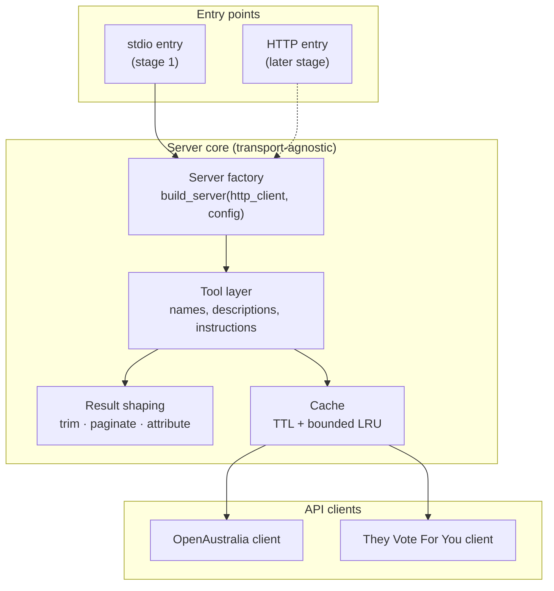
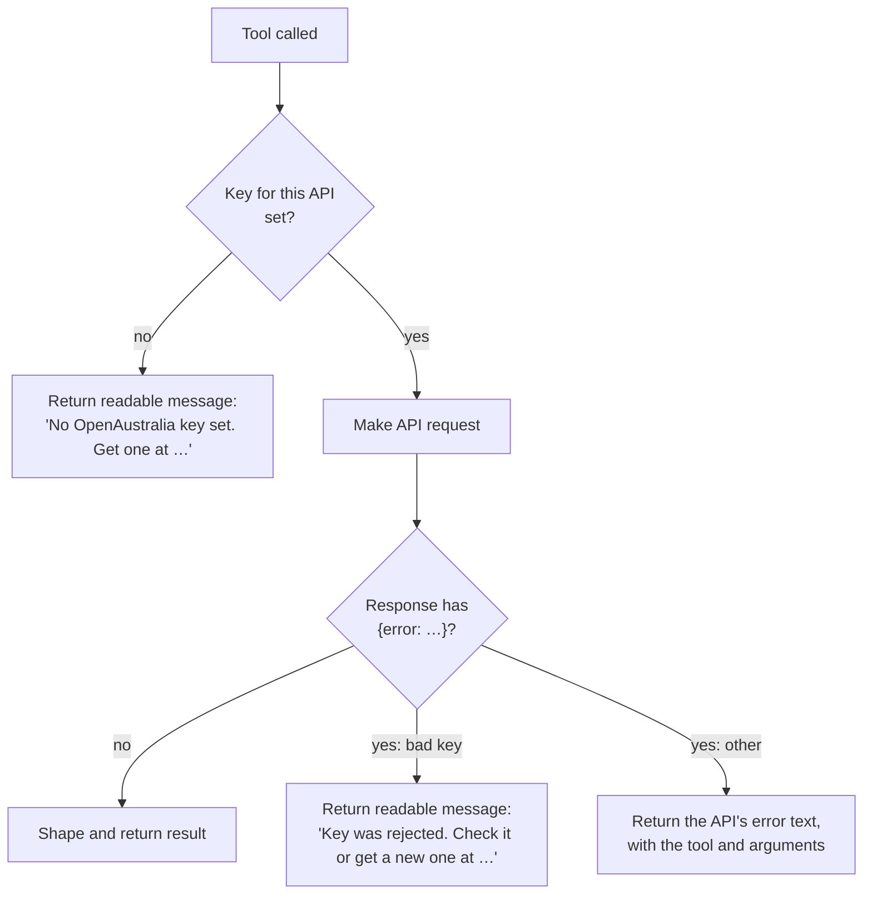
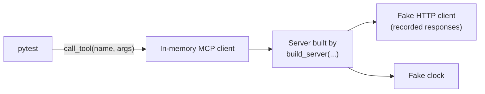
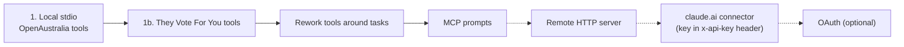

# Architecture

How the OpenAustralia MCP server is put together, and why. It started as a draft before any code existed, and it's updated as tools are built. Where something hasn't been verified yet, it's marked **unverified**.

## Overview

The server is a local MCP server, written in Python, that Claude Desktop or Claude Code starts as a child process and talks to over stdio. When Claude calls a tool, the server makes the matching HTTP GET calls to OpenAustralia or They Vote For You, cuts the response down to what the model needs, adds a source link, and returns it.

The server stores nothing on disk and never changes data. Keys are read from the environment the client passes to the process.

## Components

| Component | Responsibility |
|---|---|
| **Entry points** | Read config, build the server, attach a transport. Stage 1 ships stdio only. The HTTP entry point is a later addition and doesn't change the core. |
| **Server factory** | The single construction point. It takes an HTTP client and the config, so tests can swap in fakes (see [Testing](#testing)). A clock parameter is added along with the cache. |
| **Tool layer** | Registers the tools with the `mcp` SDK (`MCPServer`, called FastMCP before 2.x) and holds the descriptions and the server `instructions` that tell the model how to chain tools. |
| **Result shaping** | Turns raw API responses into small, citable results (the result models in `models.py`). This is where most of the design work goes. |
| **Cache** | Avoids repeat calls for data that rarely or never changes. |
| **API clients** | One per API. They build requests, attach the key, turn error responses into typed errors, and parse responses into pydantic models that keep the API's own field names (e.g. `Representative`). They don't know anything about MCP. The tool functions decide what to do with gaps in the data, and map API models onto result models. |

## Tools

At first the tools follow the API functions one to one, with three changes: results are trimmed, results include the IDs the next call needs, and some names are changed so they don't mislead the model. Once real use shows where Claude struggles, the tools will be reworked around tasks.

| Tool | API call(s) | Returns |
|---|---|---|
| `get_members` | OA `getRepresentatives`, `getRepresentative`, `getSenators`, `getSenator` | Members with `person_id`, house, party, electorate/state |
| `get_electorates` | OA `getDivisions` | Electorates (electoral divisions) |
| `search_hansard` | OA `getHansard` | 20 hits (one OpenAustralia page): speaker, `person_id`, date, house, debate title, excerpt, `gid`, URL. Plus the total number of hits |
| `read_debate` | OA `getDebates` (by `gid` and `type`) | Up to ~4,000 characters per call, plus `offset` for the next page |
| `get_policies`, `get_policy` | TVFY `/policies` | Policy topics, with each member's agreement score |
| `get_votes`, `get_vote` | TVFY `/divisions` | Individual votes and how each member voted |

Notes on naming:

- **"Divisions" means two different things.** OpenAustralia's `getDivisions` returns electorates, while They Vote For You's `/divisions` returns votes. The tools are named `get_electorates` and `get_votes` so the model can't mix them up.
- **Only one tool looks up members.** They Vote For You's people data is folded into the policy and vote results instead of getting its own tool.
- **`getComments` is left out.**

Exact parameters per tool are taken from the `openaustralia` Python package docs and from live calls, because both API docs sites are behind a Cloudflare challenge. Recorded responses are in `tests/fixtures/`.

What live calls have shown so far (OpenAustralia):

- **Request:** `GET https://www.openaustralia.org.au/api/<function>?key=…&output=js&…`. `getRepresentatives` takes `postcode`, `date`, `party` and `search`.
- **Response:** a JSON array. IDs come back as strings (`"person_id": "10887"`). Name, party and electorate are `full_name`, `party` and `constituency`. `office` lists positions, where `to_date: "9999-12-31"` means current.
- **Errors:** HTTP 200 with `{"error": "…"}`. A bad key gives `"Invalid API key."` and an unknown postcode gives `"Unknown postcode"`.
- **Postcodes in abolished electorates:** OpenAustralia's postcode data still includes electorates abolished in the 2025 redistribution, such as Higgins. `getRepresentatives` puts `false` in the list where a division has no current member. 3142 gives `[false]`, and 3181 gives `[false, Josh Burns]`. `get_members` skips the `false` entries. If some were skipped, it adds a `note` saying the list may be incomplete. If none are left, it says no current member is on record.
- **Encoding:** the header says `charset=iso-8859-1`, but all 150 current members come back as plain ASCII.
- **Member page URL:** `https://www.openaustralia.org.au/mp/?p=<person_id>` is **unverified**. The website returns 403 to scripts.
- **Past dates:** `getRepresentatives?date=2015-01-01` returned `{}`, not a list. Not yet understood.
- **`getHansard`** takes `search`, `person`, `order` and `page`, and needs at least one. With none, it returns `{"error": "No parameter provided…"}`. Passing `num` gives HTTP 500, so a page is always 20 rows. The default `order` is `d` (newest first). `r` sorts by relevance.
- **`getHansard` response:** `{"info": {…, "total_results"}, "rows": […]}`. No hits gives `rows: {}` (an empty PHP array, not `[]`), also for a `person` that doesn't exist. Each row has `gid`, `hdate`, `major` (`"1"` House, `"101"` Senate), `body`, `listurl`, `speaker` (with `person_id`) and `parent.body` (the debate title). All 300 rows sampled had a speaker and a parent.
- **Hansard excerpts:** `body` is already an excerpt of about 400 characters, made by OpenAustralia. It contains `` around the search terms and HTML entities such as `&#8212;`. `listurl` is a relative, HTML-escaped link to the speech, under `/debates/` or `/senate/`.
- **`getDebates`** takes `type` (`representatives` or `senate`) and `gid`. Without a `type` it returns `{"error": "You must supply a type"}`, and an unknown `type` gives `{"error": "Unknown type"}`.
- **`gid`s repeat across houses.** `2026-06-23.80.1` is Peter Khalil in the House and Lidia Thorpe in the Senate. The wrong `type` silently returns the other house's speech, so the house has to come with the `gid`. `search_hansard` hits carry it.
- **`getDebates` response:** a JSON array of entries, each with `gid`, `htype`, `hdate`, `body` and `listurl`. A speech `gid` gives three entries: the section heading (`htype` 10, e.g. "Matters of Public Importance"), the subsection heading (`htype` 11, e.g. "Budget") and the speech (`htype` 12, with `speaker`). The two headings together make `getHansard`'s `parent.body`. A heading `gid` (the `id=` in a speech's `listurl`) gives the whole debate: for `2026-06-23.78.2`, the 2 headings and 14 speeches. Headings have `speaker: {}` or no `speaker`.
- **Debate text:** `body` is HTML with `
` and `<i>` tags and entities such as `&#8212;`. One speech by Peter Khalil is 8,715 characters as plain text, and its whole debate is about 51,000.
- **Unknown `gid`:** HTTP 404 with an HTML page, not an `{"error": …}` body. A malformed `gid` gives the same.

What live calls have shown so far (They Vote For You):

- **Request:** `GET https://theyvoteforyou.org.au/api/v1/<path>.json?key=…`, e.g. `people.json`, `people/<id>.json`, `divisions.json`, `divisions/<id>.json`. `divisions.json` takes `house`, `start_date` and `end_date`, and returns up to 100 votes.
- **Response:** real JSON (`application/json; charset=utf-8`), with integer IDs. `people.json` lists current members only: 226, the same as OpenAustralia's 150 Representatives plus 76 Senators.
- **Same IDs as OpenAustralia:** a person's `id` is OpenAustralia's `person_id`, and `latest_member.id` is OpenAustralia's `member_id`. All 226 current members matched on both, and on name, electorate and house. Former members match too: the 8 former members checked from a 2015 vote came back with the same name from OpenAustralia's `getRepresentative?id=<id>`. In a vote, each member is `member.person.id`.
- **Party labels differ for presiding officers:** OpenAustralia says `Speaker`, `President` and `Deputy-President`, and They Vote For You says `SPK`, `PRES` and `DPRES`.
- **Policy scores:** `people/<id>.json` includes `policy_comparisons`, each with the policy, `agreement` (a percentage as a string, e.g. `"100"`) and `voted`.

Status: `get_members` covers postcode lookup of Representatives only. Name and party search and Senators come next. `search_hansard` searches by query, `person_id` or both, and returns the first page of 20. Paging and `order` come next. `read_debate` reads a speech gid, or a heading gid for the whole debate, 4,000 characters at a time. Its cache by `gid` comes next.

## A typical question

"What has my MP said about housing, and how do they vote on it?"

Every result includes the IDs the next call needs (`person_id` → `gid`). The model never has to guess at API syntax.

The last step relies on They Vote For You using the same `person_id`s as OpenAustralia. Live calls confirmed it does (see [Tools](#tools)), so a `person_id` from `get_members` can be passed straight to the voting tools, with no matching across the two APIs.

## Keys and errors

- **Validation is lazy.** The server always starts, and a key problem comes back as a tool result that Claude can explain to the user. Failing at startup would only show up in Claude Desktop as an unhelpful "server disconnected".
- **Each key is independent.** Missing a They Vote For You key disables only the voting tools.
- **Keys never appear in logs, results or errors.** OpenAustralia only accepts the key in the query string, so every request URL contains it. That's why:
  - `build_server` raises the `httpx2` and `httpcore2` loggers to WARNING. At INFO, httpx2 logs every request URL, and the SDK writes INFO logs to stderr.
  - The API clients catch HTTP errors and re-raise them `from None` with the status only, because httpx2 errors carry the request and its URL.
  - Tests check results and captured logs for a sentinel key.
  - A pre-commit hook and CI scan with gitleaks for a key in a `key=` query, a `"key"` field or an `…_API_KEY` setting, in case a fixture or doc is committed unscrubbed.
- **Network failures, non-200 statuses and non-JSON bodies** (such as a Cloudflare challenge page) all return "couldn't be reached" or "didn't respond normally (HTTP …)".

## Result shaping

Hansard responses are long, and model context is limited. The rules:

| Rule | Default |
|---|---|
| Search hits per page | 20, OpenAustralia's fixed page size |
| Excerpt | OpenAustralia's own (~400 characters), with markup stripped and entities decoded |
| `read_debate` page size | ~4,000 characters, with an `offset` for the next page |
| Attribution | Every result ends with a source URL and the licence line |
| Hansard text | Cut, never rewritten or summarised on the server (CC BY-NC-ND: no derivatives) |

These defaults are starting values, to be tuned once recorded responses show real sizes.

## Caching

The cache is in memory only, and is lost when the process exits.

| Data | Policy | Why |
|---|---|---|
| Members, electorates | 24-hour TTL | Rarely change, and almost every question looks up a `person_id` |
| TVFY policies | 24-hour TTL | Rarely change |
| Debate text (by `gid` and house) | Bounded LRU (~50 items). Not built yet | Published Hansard never changes, and paging with `offset` would otherwise download the whole debate again for every page. The key needs the house, because gids repeat across houses |
| Searches | Not cached | New sitting days change the results, and a stale search could silently miss today's debate |

## Testing

The tests use a single seam, the MCP tool call, plus two dependencies the factory injects.

- **Unit tests** call tools through an in-memory MCP client, the same way a real client does, and check the result: trimming, IDs, attribution and error messages. HTTP is served from recorded responses, so no key is needed and the tests run in CI.
- **Cache tests** move the fake clock forward to check the TTL, and count HTTP calls to check that paging through one `gid` fetches it only once.
- **Live smoke tests** use the same tool-level seam with a real HTTP client. They run only when the key env vars are set. CI runs them in `live.yml` every Sunday at 20:17 UTC, by hand, and on pull requests that change them, and fails if the key secret is missing rather than letting them skip.
- **Manual testing** uses MCP Inspector.

Nothing below the tool call is tested on its own. That keeps the internals free to change when the tools are reworked around tasks.

## Key decisions

| Decision | Choice | Reason |
|---|---|---|
| Language | Python, `uv`, the official `mcp` SDK (2.x) | Less boilerplate. The focus is MCP, not the language. |
| HTTP client | `httpx2` | The `mcp` 2.x SDK already depends on it, so the server has one HTTP stack, not two |
| Transport | stdio first, with a transport-agnostic core | Local use needs no hosting, and HTTP can be added later without a refactor |
| Servers | One server, two API clients | Speech and votes join on the member, both APIs use the same `person_id`, and one server can name things clearly |
| Tool shape | One tool per API function, for now | Real usage should drive the redesign around tasks |
| Workflow guidance | Server `instructions` and tool descriptions | The model always sees these. Prompts and resources are chosen by the user, not the model. |
| Key validation | On first call | Readable errors instead of an opaque startup crash |
| Hansard search page size | 20 hits, one OpenAustralia page | `getHansard` can't return fewer (`num` gives HTTP 500), and paging can later map straight onto its `page` |
| Hansard excerpt | OpenAustralia's own, markup stripped | It's already short. Cutting further would lose context for little saving. |
| `read_debate` house | A required argument, with no default | gids repeat across houses, and the wrong house silently returns a different speech. `search_hansard` hits already carry the house. |
| `read_debate` text | Each speech after its speaker's name, paragraphs kept, paged by character offset over the joined text | One shape for a single speech and a whole debate. Character offsets stay valid between calls because published Hansard doesn't change. |
| HTTP 404 from OpenAustralia | "Not found", naming the gid and house | `getDebates` sends a 404 page for an unknown gid, and "try again later" would send Claude round in circles |
| Distribution | `uvx --from git+…` | No release process needed. PyPI later. |
| Live tests in CI | A separate weekly workflow, with the OpenAustralia key in a repository secret | Recorded responses can't show the API changing. Weekly keeps the load on a charity's free API small, and a separate workflow keeps the key out of the jobs that run on every push |
| Committed-key check | gitleaks with a custom rule in `.gitleaks.toml`, run by a pre-commit hook and again in CI | GitHub's secret scanning only knows its partners' key formats, which don't include OpenAustralia or They Vote For You. The hook stops a key before it's committed. CI catches clones without the hook, and `--no-verify` |
| Code licence | MIT | Data licences are documented separately |

## Open questions

- What exact parameters does each OpenAustralia and They Vote For You function take? (`getRepresentatives` is done. See [Tools](#tools).)
- Is `/mp/?p=<person_id>` the right member page URL?
- How well do the result-size defaults hold up against real responses?
- How should tools reject unknown arguments? The `mcp` SDK builds each tool's arguments model with pydantic's default `extra="ignore"` and has no setting to change it. So a misnamed argument is dropped silently: `search_hansard(query="housing", person="10887")` searches every member's speeches. A wrong type, such as a number for `person_id`, is already rejected before any request. A fix would mean setting `extra="forbid"` through the SDK's private `_tool_manager`, or a change upstream.

## Later stages

For the remote stages, the server would read keys from request headers instead of env vars, for each request. The core stays the same. Only the entry point and how the config is supplied change.
