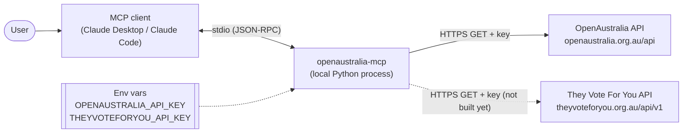
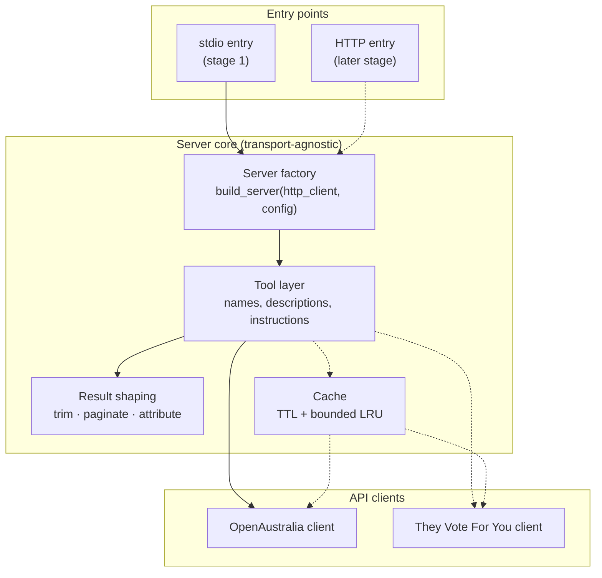
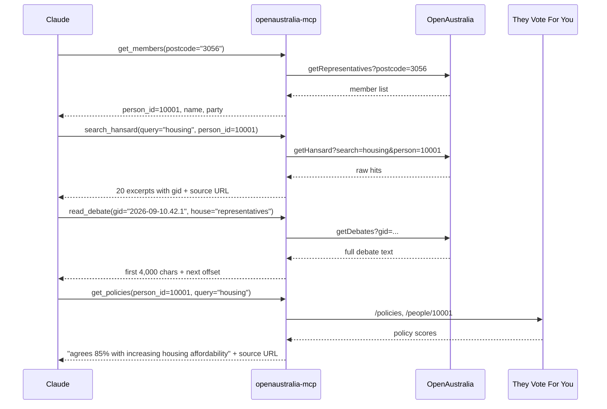
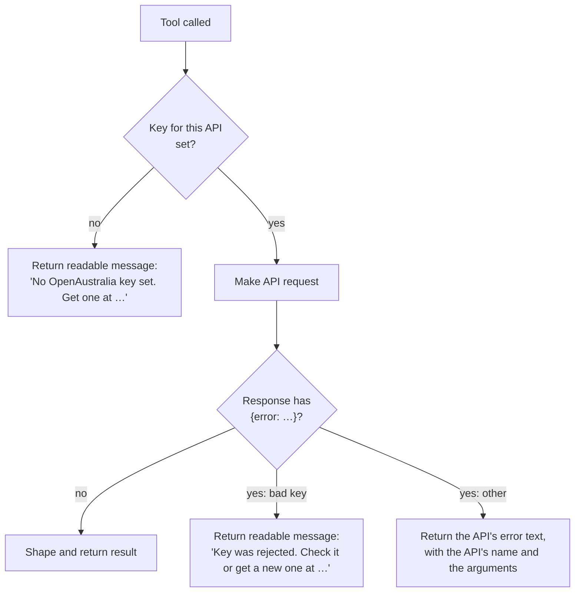
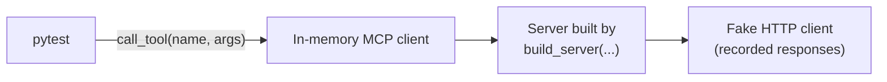

# Architecture

How the OpenAustralia MCP server is put together. It's updated as tools are built. [tools.md](tools.md) covers the tools, [api-notes.md](api-notes.md) what the APIs actually do, and [adr/](adr/) the decisions behind the design.

## Overview

The server is a local MCP server, written in Python, that Claude Desktop or Claude Code starts as a child process and talks to over stdio. When Claude calls a tool, the server makes the matching HTTP GET calls to OpenAustralia or They Vote For You, cuts the response down to what the model needs, adds a source link, and returns it.

The server stores nothing on disk and never changes data. Keys are read from the environment the client passes to the process.

## Components

Dashed lines aren't built yet.

| Component | Responsibility |
|---|---|
| **Entry points** | Read config, build the server, attach a transport. Stage 1 ships stdio only. The HTTP entry point is a later addition and doesn't change the core ([ADR 0002](adr/0002-stdio-first.md)). |
| **Server factory** | The single construction point. It takes an HTTP client and the config, so tests can swap in fakes (see [Testing](#testing)). Each server it builds gets its own API clients, in its lifespan, so tests and the evals' concurrent trials never share one. A clock parameter is added along with the cache. |
| **Tool layer** | Registers the tools with the `mcp` SDK (`MCPServer`, called FastMCP before 2.x) and holds the descriptions and the server `instructions` that tell the model how to chain tools. The `instructions` are in `server.py`, because they span the tools. Each family of tools has a module in `tools/`, `members.py` and `hansard.py` so far. Its tools are plain functions, listed in its `TOOLS` in the order Claude sees them, and `build_server` adds them with the SDK's `add_tool`. A tool reads its server's clients from its `ctx: Context[Clients]`, as the SDK's [Lifespan docs](https://py.sdk.modelcontextprotocol.io/handlers/lifespan/) show. See [tools.md](tools.md). |
| **Result shaping** | Turns raw API responses into small, citable results: the result models, each in the module of the tools that return it. Each result model's `from_…` constructor sets its `source_url` and licence. This is where most of the design work goes. See [tools.md](tools.md#result-shaping). |
| **Cache** | Will avoid repeat calls for data that rarely or never changes. Not built yet. See [tools.md](tools.md#caching). |
| **API clients** | One per API, in one server ([ADR 0001](adr/0001-one-server-over-both-apis.md)), though only the OpenAustralia client is built so far. They build requests, attach the key, turn error responses into typed errors, and parse responses into pydantic models that keep the API's own field names (e.g. `Representative`). They don't know anything about MCP. The tool functions decide what to do with gaps in the data, and map API models onto result models. |

## A typical question

"What has my MP said about housing, and how do they vote on it?"

Every result includes the IDs the next call needs (`person_id` → `gid`). The model never has to guess at API syntax.

The last step isn't built yet. It relies on They Vote For You using the same `person_id`s as OpenAustralia. Live calls confirmed it does (see [api-notes.md](api-notes.md#they-vote-for-you)), so a `person_id` from `get_members` can be passed straight to the voting tools, with no matching across the two APIs.

## Keys and errors

- **Validation is lazy.** The server always starts, and a key problem comes back as a tool result that Claude can explain to the user. Failing at startup would only show up in Claude Desktop as an unhelpful "server disconnected".
- **Each key is independent.** Once the voting tools are built, missing a They Vote For You key will disable only those. The server doesn't read that key yet.
- **Keys never appear in logs, results or errors.** OpenAustralia only accepts the key in the query string, so every request URL contains it. That's why:
  - `build_server` raises the `httpx2` and `httpcore2` loggers to WARNING. At INFO, httpx2 logs every request URL, and the SDK writes INFO logs to stderr.
  - The API clients catch HTTP errors and re-raise them `from None` with the status only, because httpx2 errors carry the request and its URL.
  - Tests check results and captured logs for a sentinel key.
  - A pre-commit hook and CI scan with gitleaks for a key in a `key=` query, a `"key"` field or an `…_API_KEY` setting, in case a fixture or doc is committed unscrubbed. It needs the custom rule in `.gitleaks.toml`, because GitHub's secret scanning only knows its partners' key formats, which don't include OpenAustralia or They Vote For You. The hook stops a key before it's committed. CI catches clones without the hook, and `--no-verify`.
  - CI runs the official [gitleaks action](https://github.com/gitleaks/gitleaks-action), pinned to a commit. It scans the commits each pull request or push to `main` adds, not the whole history. On a pull request it asks GitHub for the pull request's commits and reads only the first 30, so a longer pull request's later commits are scanned when it's squash-merged into `main`. The action caches gitleaks between runs. Before, the job downloaded gitleaks from GitHub's releases on every run, and those downloads failed with HTTP 504 on 2026-11-08. The action still downloads on a cache miss, so an outage like that can still fail the job.
  - The evals' Anthropic key needs no custom rule. gitleaks' default `anthropic-api-key` rule, which `.gitleaks.toml` keeps, caught a fake key in four forms under v8.28.0: on its own, as `ANTHROPIC_API_KEY=…`, as a JSON value and as a Python argument. It doesn't flag the `.env.example` placeholder.
- **Network failures, non-200 statuses and non-JSON bodies** (such as a Cloudflare challenge page) all return "couldn't be reached" or "didn't respond normally (HTTP …)".
- **A 404 from `getDebates`** is how OpenAustralia answers an unknown gid, so `read_debate` says it has no speech or debate with that gid in that house. "Try again later" would send Claude round in circles.

## Testing

The tests use a single seam, the MCP tool call, with a fake HTTP client passed to the factory.

- **Unit tests** call tools through an in-memory MCP client, the same way a real client does, and check the result: trimming, IDs, attribution and error messages. HTTP is served from recorded responses, so no key is needed and the tests run in CI. Each recorded response answers only the request it was recorded for (`RECORDED` in `tests/fake_api.py`), and any other request gets a 404.
- **Cache tests** will come with the cache. They'll move a fake clock forward to check the TTL, and count HTTP calls to check that paging through one `gid` fetches it only once.
- **Live smoke tests** use the same tool-level seam with a real HTTP client. They run only when the key env vars are set. CI runs them in `live.yml` every Sunday at 20:17 UTC, by hand, and on pull requests that change them, and fails if the key secret is missing rather than letting them skip. Recorded responses can't show the API changing. Weekly keeps the load on a charity's free API small, and a separate workflow keeps the key out of the jobs that run on every push.
- **Manual testing** uses MCP Inspector.
- **Evals** check what the tests can't: whether Claude picks the right tool, fills in the right arguments and chains the calls. They cost money and aren't deterministic, so they live outside pytest. See [evals.md](evals.md).

Nothing below the tool call is tested on its own ([ADR 0004](adr/0004-test-through-the-tool-call.md)).

## Stack

- **Python, `uv` and the official `mcp` SDK (2.x).** Less boilerplate. The focus is MCP, not the language.
- **Python 3.13 or later.** A tool's description is its function's docstring, exactly as Python gives it, and 3.13 is the first version to strip a docstring's indentation. On 3.12, Claude got every line of a description after the first indented by 8 spaces, which no eval measured ([#32](https://github.com/jeremiah-wa/openaustralia-mcp/issues/32)).
- **`httpx2` for HTTP.** The `mcp` 2.x SDK already depends on it, so the server has one HTTP stack, not two.
- **Distributed with `uvx --from git+…`.** No release process needed. PyPI later.
- **MIT for the code.** The data has its own [licences](../README.md#data-and-licences).

## Decisions

The decisions that are hard to reverse, surprising without context and a real trade-off are in [adr/](adr/), one file each. Smaller ones are recorded next to what they decide.

## Open questions

- What exact parameters does each OpenAustralia and They Vote For You function take? (`getRepresentatives` is done. See [api-notes.md](api-notes.md#openaustralia).)
- How well do the result-size defaults hold up against real responses?
- How should tools reject unknown arguments? The `mcp` SDK builds each tool's arguments model with pydantic's default `extra="ignore"` and has no setting to change it. So a misnamed argument is dropped silently: `search_hansard(query="housing", person="10887")` searches every member's speeches. A wrong type, such as a number for `person_id`, is already rejected before any request. A fix would mean setting `extra="forbid"` through the SDK's private `_tool_manager`, or a change upstream.

## Later stages

The order is in the [README's roadmap](../README.md#roadmap). For the remote stages, the server would read keys from request headers, such as `x-api-key`, instead of env vars, for each request. The core stays the same. Only the entry point and how the config is supplied change. OAuth could come after that, as an option. Docker packaging gets revisited at this stage ([#1](https://github.com/jeremiah-wa/openaustralia-mcp/issues/1)).
