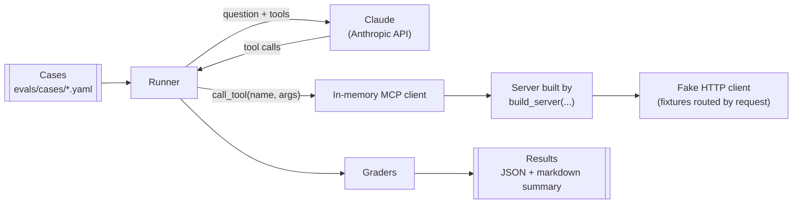

# Evals

How the evals measure whether Claude uses the tools well, and why they're built this way. The runner and the first cases are built in [#6](https://github.com/jeremiah-wa/openaustralia-mcp/issues/6). Where something hasn't been checked yet, it's marked **unverified**.

## Why

The unit tests prove that a tool works once it's called. They can't show that Claude calls it: that it picks the right tool, fills in the right arguments and chains the calls. Tool names, descriptions, argument schemas and the server `instructions` are all written for the model, and the evals check them by measurement instead of by reading.

The first question they answer is whether member lookup should be more tools or more parameters ([#8](https://github.com/jeremiah-wa/openaustralia-mcp/issues/8)). After that, every change to a tool's name, description or arguments is measured before and after (see [contributing.md](contributing.md#evals)).

## How a run works



1. The runner loads a case and connects an in-memory MCP client to a server built by `build_server`, with a fake HTTP client that answers from recorded fixtures.
2. It lists the server's tools, turns them into Claude tool definitions, and sends the case's question with the server `instructions` as the system prompt.
3. Each tool call Claude makes goes through the MCP client, as it would from a real client. The runner records the call as Claude sent it, and the result Claude got back.
4. The trial ends when Claude answers, or at the turn cap.
5. The graders score the recorded calls and the final answer. This repeats for every trial and every model.

## The seam

The evals use the same seam as the tests (see [Testing](architecture.md#testing)): `build_server(http_client, config)` with an `httpx2.MockTransport`. There's no subprocess, no OpenAustralia key, and no network apart from the Anthropic API.

Recorded fixtures are **routed by request**. A request is matched on the API function and its parameters, with the key ignored, to a fixture under `tests/fixtures/`. A fixture holds only the response, so `RECORDED` in [tests/fake_api.py](../tests/fake_api.py) lists the request each one answers, and `FakeApi.route(name)` serves it for that request only. The tests route their recorded results the same way. `FakeApi.serve_fixture`, which answers every request with one fixture, is kept for error fixtures such as a rejected key.

Search queries are free text, so one exact `search` value would fail a reasonable call such as "NDIS Senate" instead of "NDIS". A case can therefore give a fixture a list of keywords (`FakeApi.route(name, search_contains=[...])`). The fixture then answers any `getHansard` request whose `search` contains one of them, ignoring case, with the other parameters still matched exactly.

A request with no matching fixture gets an HTTP 404. The server returns it to Claude as a tool error, and the run carries on. The trial is scored on its expected calls as usual, so a wrong call shows up as a missing expected one, or as one call too many.

## The runner

The runner ([evals/runner.py](../evals/runner.py)) is Python, using the Anthropic SDK's tool runner (beta). `async_mcp_tool` from `anthropic.lib.tools.mcp` turns each MCP tool into a Claude tool definition and calls it through the MCP session. The in-memory `Client` gives that session as `client.session`. The runner wraps it in a `RecordingSession`, which records each call's arguments and full result before passing the result on. [ADR 0006](adr/0006-hand-written-eval-runner.md) records why it's hand-written.

| Setting | Choice | Why |
|---|---|---|
| Loop | The SDK's tool runner. A hand-written loop is the fallback if the runner gets in the way of recording calls | Less code, and the SDK maintains the conversion of MCP tools and results |
| System prompt | The server's `instructions` (`client.instructions`), and nothing else | Claude Code puts server instructions in its system prompt. Leaving them out would leave them untested |
| Turn cap | 8 model turns, as the tool runner's `max_iterations` | The longest chain today is 3 or 4 calls. A trial whose last reply still asks for a tool hit the cap, and fails |
| Recorded per trial | Each tool call's name and input exactly as Claude sent it, each result, the final answer, `stop_reason`, token usage, the model and the effort level | The raw input shows misnamed arguments, which the server drops silently (see [Open questions](architecture.md#open-questions)) |

Checked while building it (anthropic 2.3, mcp 2.3):

- `async_mcp_tool` works with the in-memory `Client`'s session. The smoke runs on Sonnet 5.5 and Haiku 5.5 called `get_members` through it.
- It passes Claude's input on as it is, so a misnamed argument reaches the server and is recorded.
- The tool runner has a turn limit, `max_iterations`, with no limit by default.
- What Claude sees from a tool result: `async_mcp_tool` sends the result's `content` blocks, and the `structured_content` only when there are none. This server's tools return one text block that holds the same JSON as the structured content, so Claude gets the same data either way. **unverified**: whether Claude Code sends the text block, the structured content, or both. For this server's tools, that changes the format but not the data.
- Refusal fallbacks are off. A fallback model answering would score the wrong model, and the runner stops the run if a response's `model` isn't the one it asked for.

## Cases

Each case is a YAML file under `evals/cases/`. This is `mp-housing-3056.yaml`:

```yaml
id: mp-housing-3056
tags: [regression, search]
question: What has my federal MP for 3056 said about housing?
fixtures:
  - getRepresentatives_postcode_3056.json
  - file: getHansard_search_housing_person_10887.json
    search_contains: [housing]
expect:
  calls:
    - id: member
      tool: get_members
      args: {postcode: "3056"}
    - tool: search_hansard
      args: {person_id: "10887"}
      args_contain: {query: [housing]}
      after: member
  forbidden:
    - tool: search_hansard
      args_missing: [person_id]
  answer_contains: [Peter Khalil]
  cites_url: true
```

| Field | Meaning |
|---|---|
| `question` | The user's message |
| `fixtures` | The recorded responses this case can use. Any other request gets a 404. `search_contains` makes a search fixture answer any query containing one of its keywords (see [The seam](#the-seam)) |
| `expect.calls` | Calls that must appear. `args` must match exactly. `args_contain` must contain one of the listed texts, ignoring case, e.g. `[NDIS, National Disability Insurance Scheme]`. Other arguments are free |
| `after` | This call needs the output of the named call, so it must come after it. Only for real dependencies, not for a preferred order |
| `forbidden` | Calls that must not appear. Give the `tool` alone, `args` that must not have those values, or `args_missing`, arguments that must not all be missing |
| `max_calls` | Optional cap on the number of tool calls. `0` means Claude should answer without a tool |
| `answer_contains` | Text the final answer must contain, ignoring case. Use it for facts from the fixtures, such as a member's name, not for phrasing |
| `cites_url` | The final answer must include a `url` from a tool result |
| `tags` | `regression` or `capability`, plus any free labels |

**Regression** cases cover what the tools already do, and should pass close to every time. **Capability** cases cover what they can't do yet, such as Senators or a pasted OpenAustralia link. They're expected to fail until the feature lands, and are reported separately so they don't pull down the regression score.

The first 16 cases, from [the list on #6](https://github.com/jeremiah-wa/openaustralia-mcp/issues/6#issuecomment-6412375709), are in [evals/cases/](../evals/cases/). They cover the current tools: 15 regression cases and a pasted OpenAustralia link as a capability case. The cases for member lookup by name and Senators (17 to 19 in that list) belong to [#8](https://github.com/jeremiah-wa/openaustralia-mcp/issues/8), because their expected calls depend on the tool shape it picks.

## Graders

All graders are deterministic. A trial passes when every check passes.

| Check | Fails when |
|---|---|
| Expected calls | An expected call is missing, or its arguments don't match |
| Dependencies | A call with `after` comes before the call it depends on |
| Forbidden calls | A forbidden call appears |
| Unknown arguments | A call has an argument that isn't in the tool's schema, such as `person=` instead of `person_id=` |
| Number of calls | There are more tool calls than `max_calls` |
| Answer content | The answer is missing any of the `answer_contains` texts |
| Citation | `cites_url` is set and the answer has no `url` from a tool result. `source_url` doesn't count, because every result has the same one |
| Turn cap | The trial reached the turn cap without a final answer |

The graders check dependencies, not an exact sequence. Requiring one fixed order rejects other valid paths ([Demystifying evals for AI agents](https://www.anthropic.com/engineering/demystifying-evals-for-ai-agents)), and an extra harmless call, such as a second search, is fine unless the case sets `max_calls`.

The graders ([evals/graders.py](../evals/graders.py)) and the case format ([evals/cases.py](../evals/cases.py)) are the eval's own logic, so they're tested directly, in `tests/test_eval_graders.py` and `tests/test_eval_cases.py`. The rule to test only through the tool call doesn't apply to them. They import only pydantic, so `uv run pytest` runs those tests without the `evals` dependency group.

An LLM judge for answer quality, such as whether Hansard is quoted as it is, can come later.

## Trials and scores

- Each case runs **5 trials** per model, because answers vary from run to run. Sonnet 5.5 and Haiku 5.5 accept only the default sampling settings, so there's no `temperature` to turn down.
- **Per case:** the pass rate (passing trials out of 5) and pass^k (whether all 5 passed). pass^k matters for regression cases, where consistency is the point: a case that passes 75% of the time passes all of 3 trials only about 42% of the time.
- **Per model and overall:** the mean pass rate and the share of cases passing every trial, split by tag. The regression score is the headline. Capability cases are reported separately.
- **Noise:** at 20 cases × 5 trials, the overall pass rate moves by about ±10 points between runs for no reason (roughly 1/√(cases × trials)). Smaller differences aren't a signal. To compare two variants, such as the two member-lookup shapes in #8, run both on the same cases, trials and model, and compare case by case.

## Models

| Model | Role | Effort |
|---|---|---|
| `claude-sonnet-5-5` | Default | `high`, set explicitly |
| `claude-haiku-5-5` | Stress test. Smaller models are more sensitive to tool design | `medium`, set explicitly |

Effort sets how deeply the model thinks, so it changes behaviour. Those are each model's defaults, but the runner sets them explicitly and records them with every run, so a change in defaults can't change the scores unnoticed. Scores are only compared between runs with the same model and effort.

The runner checks that the `model` in each response is the one it asked for. If not, it stops the whole run, with no summary, because the scores would be meaningless.

## Errors

API errors that remain after the SDK's retries, timeouts, and runner crashes go to `errors.jsonl`, not into the scores. A trial that ends in an error is run again, up to 3 attempts in all, not scored as a failure, because a failure has to mean something about the tools. The summary shows the number of errors. An error line holds the exception's type and HTTP status only, never its message, which could include request details.

## Results

| What | Where | Committed |
|---|---|---|
| One JSON line per trial: case, model, effort, calls, results, answer, grades, token usage | `evals/results/runs/<timestamp>/trials.jsonl` | No, gitignored |
| Trials that ended in an error | Same folder, `errors.jsonl` | No |
| A markdown summary per run: scores by model and tag, cases by model, failure reasons, cost | Same folder, `summary.md` | No |
| The run's scores: passes per case and model, and each model's effort and cost per trial | Same folder, `scores.json` | No |
| The baseline: a run's `summary.md` and `scores.json` | `evals/results/baseline.md` and `baseline.json` | Yes. Every run's summary ends with a comparison with `baseline.json`, over the cases both have. A pull request that changes a tool updates both when it merges |

Pull requests compare with the baseline without committing every run. CI reads the scores and the cost per trial from `baseline.json`, not from the markdown.

## Where it lives

- `evals/` at the top level, outside pytest's `testpaths`. Evals cost money and aren't deterministic, so `uv run pytest` never runs them.
- An `evals` dependency group with `anthropic[mcp]`. It's not a runtime dependency.
- They're run by hand, with the command in the README, and in CI only in [evals.yml](../.github/workflows/evals.yml): by hand from the Actions tab (models, trials and cost cap as inputs), or when a pull request gets the `run-evals` label. Never on a push, because each run costs money (see [Cost](#cost)), and never in `ci.yml`, which keeps the Anthropic key out of the jobs that run on every push. The job writes the summary and the comparison with the baseline to the job summary, uploads the run's files as an artifact, and doesn't fail on the scores. There's no threshold until there are a few runs to compare.

## Keys

- `ANTHROPIC_API_KEY` comes from the environment, for example `.env` with `uv run --env-file .env`. Only the evals use it. The server never reads it.
- No OpenAustralia key is needed, because every request is answered from fixtures. The server gets a placeholder key, as in the tests.
- The Anthropic key never appears in results, logs or errors.

## Cost

A run costs cases × trials × models × the cost of one trial. The cost of a trial is measured from the token usage in the results and priced per model. In October 2026, Sonnet 5.5 costs $2 per million input tokens and $10 per million output tokens, and Haiku 5.5 costs $0.10 and $0.50.

Before starting, the runner prints an estimate from the cost per trial in the latest local run that used each model, or else in `baseline.json`, which is what a CI runner has. `--max-cost-usd` is required. The runner refuses a run whose estimate is over it, before any API call, and stops starting new trials once it's spent. Trials already running finish, so a run can go slightly over.

Measured in the [baseline](../evals/results/baseline.md), across the 16 cases: $0.0281 a trial on Sonnet 5.5 and $0.0015 on Haiku 5.5. The full baseline, 16 cases × 5 trials on both models, cost $2.37. A one-call case such as `mp-3056` costs about a third of the Sonnet average.

## Later

- An LLM judge for answer quality.
- `claude plugin eval` on a small subset of cases. It runs them inside the real Claude Code, with its system prompt, tool naming and tool search, which can hide MCP tools until Claude searches for them. That's worth checking before a tool-shape decision such as #8 is locked in. It and the other options considered are compared in [this comment on #5](https://github.com/jeremiah-wa/openaustralia-mcp/issues/5#issuecomment-6411528943).
