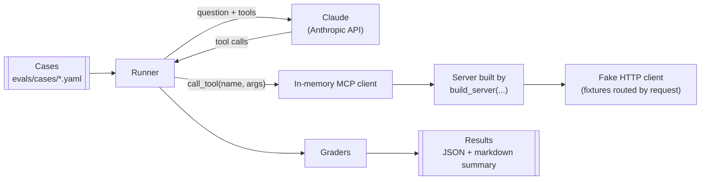

# Evals

How the evals measure whether Claude uses the tools well, and why they're built this way. The runner and the first cases are built in [#6](https://github.com/jeremiah-wa/openaustralia-mcp/issues/6). Where something hasn't been checked yet, it's marked **unverified**.

## Why

The unit tests prove that a tool works once it's called. They can't show that Claude calls it: that it picks the right tool, fills in the right arguments and chains the calls. Tool names, descriptions, argument schemas and the server `instructions` are all written for the model, and the evals check them by measurement instead of by reading.

The first question they answer is whether member lookup should be more tools or more parameters ([#8](https://github.com/jeremiah-wa/openaustralia-mcp/issues/8)). After that, every change to a tool's name, description or arguments is measured before and after (see [contributing.md](contributing.md#evals)).

## How a run works



1. The runner loads a case and connects an in-memory MCP client to a server built by `build_server`, with a fake HTTP client that answers from recorded fixtures.
2. It lists the server's tools, turns them into Claude tool definitions, and sends the case's question with the server `instructions` as the system prompt.
3. Each tool call Claude makes goes through the MCP client, as it would from a real client. The runner records the call as Claude sent it, and the result Claude got back.
4. The trial ends when Claude answers, or at the turn cap.
5. The graders score the recorded calls and the final answer. This repeats for every trial and every model.

## The seam

The evals use the same seam as the tests (see [Testing](architecture.md#testing)): `build_server(http_client, config)` with an `httpx2.MockTransport`. There's no subprocess, no OpenAustralia key, and no network apart from the Anthropic API.

Recorded fixtures are **routed by request**. A request is matched on the API function and its parameters, with the key ignored, to a fixture under `tests/fixtures/`. Today's `FakeApi` serves one fixture for every request, which works for a test that makes one known call, but not for a run where Claude decides the calls. The router replaces `FakeApi.serve_fixture` in the tests too (#6).

A request with no matching fixture gets an HTTP 404. The server returns it to Claude as a tool error, and the run carries on. The trial is scored on its expected calls as usual, so a wrong call shows up as a missing expected one, or as one call too many.

## The runner

The runner is Python, using the Anthropic SDK's tool runner (beta). `async_mcp_tool` from `anthropic.lib.tools.mcp` turns each MCP tool into a Claude tool definition and calls it through the MCP session. The in-memory `Client` gives that session as `client.session`.

| Setting | Choice | Why |
|---|---|---|
| Loop | The SDK's tool runner. A hand-written loop is the fallback if the runner gets in the way of recording calls | Less code, and the SDK maintains the conversion of MCP tools and results |
| System prompt | The server's `instructions` (`client.instructions`), and nothing else | Claude Code puts server instructions in its system prompt. Leaving them out would leave them untested |
| Turn cap | 8 model turns | The longest chain today is 3 or 4 calls. Hitting the cap is recorded and fails the trial |
| Recorded per trial | Each tool call's name and input exactly as Claude sent it, each result, the final answer, `stop_reason`, token usage, the model and the effort level | The raw input shows misnamed arguments, which the server drops silently (see [Open questions](architecture.md#open-questions)) |

Not yet checked:

- **unverified**: that `async_mcp_tool` works with the in-memory `Client`. It takes a `ClientSession` and calls `call_tool(name=..., arguments=...)`, and `Client.session` returns one with that signature, but it hasn't been run.
- **unverified**: whether the tool runner has a built-in turn limit. If it doesn't, the runner counts turns itself and stops at the cap.
- **unverified**: what Claude sees from a tool result. The tools return structured content and a text block. The runner should pass on the same parts that Claude Code passes to the model, or the evals measure a result format no real client sends.

## Cases

Each case is a YAML file under `evals/cases/`. This example shows the intended shape. #6 may change the field names.

```yaml
id: mp-housing-3056
tags: [regression]
question: What has my federal MP for postcode 3056 said about housing?
fixtures:
  - getRepresentatives_postcode_3056.json
  - getHansard_search_housing_person_10887.json
expect:
  calls:
    - id: member
      tool: get_members
      args: {postcode: "3056"}
    - tool: search_hansard
      args: {person_id: "10887"}
      args_contain: {query: housing}
      after: member
  forbidden:
    - tool: search_hansard
      args_missing: [person_id]
  max_calls: 4
  cites_url: true
```

| Field | Meaning |
|---|---|
| `question` | The user's message |
| `fixtures` | The recorded responses this case can use. Any other request gets a 404 |
| `expect.calls` | Calls that must appear. `args` must match exactly. `args_contain` must contain the text, ignoring case. Other arguments are free |
| `after` | This call needs the output of the named call, so it must come after it. Only for real dependencies, not for a preferred order |
| `forbidden` | Calls that must not appear |
| `max_calls` | Optional cap on the number of tool calls |
| `cites_url` | The final answer must include a `url` from a tool result |
| `tags` | `regression` or `capability`, plus any free labels |

**Regression** cases cover what the tools already do, and should pass close to every time. **Capability** cases cover what they can't do yet, such as Senators or a pasted OpenAustralia link. They're expected to fail until the feature lands, and are reported separately so they don't pull down the regression score.

## Graders

All graders are deterministic. A trial passes when every check passes.

| Check | Fails when |
|---|---|
| Expected calls | An expected call is missing, or its arguments don't match |
| Dependencies | A call with `after` comes before the call it depends on |
| Forbidden calls | A forbidden call appears |
| Unknown arguments | A call has an argument that isn't in the tool's schema, such as `person=` instead of `person_id=` |
| Number of calls | There are more tool calls than `max_calls` |
| Citation | `cites_url` is set and the answer has no `url` from a tool result |

The graders check dependencies, not an exact sequence. Requiring one fixed order rejects other valid paths ([Demystifying evals for AI agents](https://www.anthropic.com/engineering/demystifying-evals-for-ai-agents)), and an extra harmless call, such as a second search, is fine unless the case sets `max_calls`.

The graders are the eval's own logic, so they get unit tests in #6. The rule to test only through the tool call doesn't apply to them.

An LLM judge for answer quality, such as whether Hansard is quoted as it is, can come later.

## Trials and scores

- Each case runs **5 trials** per model, because answers vary from run to run. Sonnet 5.5 and Haiku 5.5 accept only the default sampling settings, so there's no `temperature` to turn down.
- **Per case:** the pass rate (passing trials out of 5) and pass^k (whether all 5 passed). pass^k matters for regression cases, where consistency is the point: a case that passes 75% of the time passes all of 3 trials only about 42% of the time.
- **Per model and overall:** the mean pass rate and the share of cases passing every trial, split by tag. The regression score is the headline. Capability cases are reported separately.
- **Noise:** at 20 cases × 5 trials, the overall pass rate moves by about ±10 points between runs for no reason (roughly 1/√(cases × trials)). Smaller differences aren't a signal. To compare two variants, such as the two member-lookup shapes in #8, run both on the same cases, trials and model, and compare case by case.

## Models

| Model | Role | Effort |
|---|---|---|
| `claude-sonnet-5-5` | Default | `high`, set explicitly |
| `claude-haiku-5-5` | Stress test. Smaller models are more sensitive to tool design | `medium`, set explicitly |

Effort sets how deeply the model thinks, so it changes behaviour. Those are each model's defaults, but the runner sets them explicitly and records them with every run, so a change in defaults can't change the scores unnoticed. Scores are only compared between runs with the same model and effort.

The runner checks that the `model` in each response is the one it asked for, and fails the trial loudly if not.

## Errors

API errors that remain after the SDK's retries, timeouts, and runner crashes go to `errors.jsonl`, not into the scores. A trial that ends in an error is run again, not scored as a failure, because a failure has to mean something about the tools. The summary shows the number of errors next to the number of trials.

## Results

| What | Where | Committed |
|---|---|---|
| One JSON line per trial: case, model, effort, calls, results, answer, grades, token usage | `evals/results/runs/<timestamp>/` | No, gitignored |
| A markdown summary per run | Same folder | No |
| The baseline summary | `evals/results/baseline.md` | Yes. A pull request that changes a tool compares against it, and updates it when it merges |

## Where it lives

- `evals/` at the top level, outside pytest's `testpaths`. Evals cost money and aren't deterministic, so `uv run pytest` never runs them.
- An `evals` dependency group with `anthropic[mcp]`. It's not a runtime dependency.
- They're run by hand, with the command in the README (#6), and on demand in their own workflow ([#7](https://github.com/jeremiah-wa/openaustralia-mcp/issues/7)). Never in `ci.yml`.

## Keys

- `ANTHROPIC_API_KEY` comes from the environment, for example `.env` with `uv run --env-file .env`. Only the evals use it. The server never reads it.
- No OpenAustralia key is needed, because every request is answered from fixtures. The server gets a placeholder key, as in the tests.
- The Anthropic key never appears in results, logs or errors.

## Cost

A run costs cases × trials × models × the cost of one trial. The cost of a trial is measured from the token usage in the results and priced per model. In October 2026, Sonnet 5.5 costs $2 per million input tokens and $10 per million output tokens, and Haiku 5.5 costs $0.10 and $0.50.

Before starting, the runner prints an estimate from the last measured cost per trial. It stops starting new trials once the `--max-cost-usd` cap is reached. The first baseline in #6 gives the first measured figure.

## Later

- An LLM judge for answer quality.
- `claude plugin eval` on a small subset of cases. It runs them inside the real Claude Code, with its system prompt, tool naming and tool search, which can hide MCP tools until Claude searches for them. That's worth checking before a tool-shape decision such as #8 is locked in. It and the other options considered are compared in [this comment on #5](https://github.com/jeremiah-wa/openaustralia-mcp/issues/5#issuecomment-6411528943).
